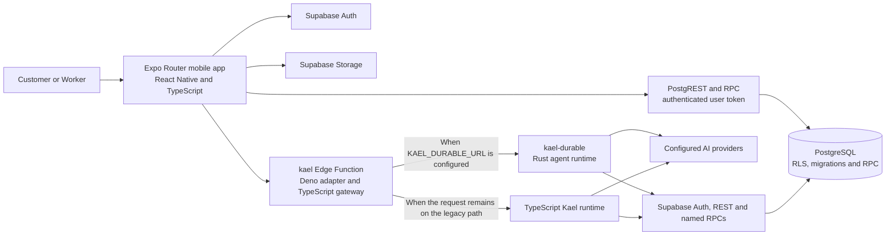

# NestScout Technical Architecture

Source snapshot reviewed: `main` at `8e113e9` (14 November 2026). This document describes repository code and database contracts. Source presence and local tests do not prove native-device behavior, hosted configuration or a complete live service.

## State labels

- **Implemented** — code or database contracts exist in this source snapshot, with local or database-level coverage where noted.
- **Legacy** — an existing path remains supported for compatibility, while new backend runtime work uses the approved Rust-first direction.
- **Planned** — product or technical direction is described, but a corresponding complete implementation is absent.
- **Unverified** — the repository cannot establish real hosted, provider, device or commercial behavior.

## System at a glance



The application has no separate general-purpose NestScout REST server. The mobile client uses Supabase Auth, PostgREST, PostgreSQL RPCs, Storage and Edge Functions. Kael has its own authenticated streaming endpoint through the `kael` Edge Function.

## Components

| Area | Current implementation |
| --- | --- |
| **Mobile** | `apps/mobile` is an Expo SDK 58, React Native and strict TypeScript application using Expo Router. Feature boundaries cover access, Customer-facing screens, Worker screens, shared repositories and the Horizon/Kael experience. |
| **Authentication** | The app has Supabase Auth paths for phone OTP, email/password and social sign-in. A restored token is treated as an unverified claim until Auth confirms the same identity with `getUser()`. Session data is persisted through the mobile storage adapter backed by Expo SecureStore on native. |
| **Customer and Worker access** | Customer and Worker are presentation modes on an account; the internal Kael/API mode string `client` corresponds to Customer. Worker mode requires a verified identity and an active, account-owned `worker_access_grants` row. Selecting Worker in the UI is not authorization. |
| **Data and API** | The mobile app uses the Supabase JavaScript client and authenticated REST/RPC helpers. PostgreSQL migrations define tables, Row Level Security and guarded functions. Generated types live in `supabase/database.types.ts`. |
| **Files and notifications** | Supabase Storage holds supported user files such as request photos. Database-backed notification records use an outbox/dispatch flow; `push-dispatch` processes delivery and `send-sms-hook` is the Auth SMS hook boundary. |
| **Kael entry point** | `supabase/functions/kael/index.ts` is a thin Deno adapter around the TypeScript gateway in `services/kael-core/src`. The gateway verifies the caller and can proxy a turn to the Rust runtime. |
| **Kael durable runtime** | `services/kael-core/durable` contains the Rust `kael-durable` process. It verifies user tokens, holds database-backed run leases, streams events and keeps a local SQLite journal/event log. The Edge gateway uses it when `KAEL_DURABLE_URL` is configured; the TypeScript runtime remains as a compatibility path. |

## API boundaries

The mobile application uses Supabase APIs directly for account and service data; it does not depend on a general-purpose NestScout REST server.

| Surface | Purpose | Trust boundary |
| --- | --- | --- |
| **Supabase Auth** — auth/v1 | Phone OTP, email/password and provider sign-in paths; session restore and identity verification. | The client re-verifies a restored session with Auth before granting protected access. |
| **PostgREST and RPC** — rest/v1 and rpc/* | Read Customer and Worker projections and submit state-changing commands. | Requests carry the user session; RLS and guarded database functions enforce ownership and allowed transitions. |
| **Supabase Storage** — storage/v1 | User media supported by the application, including service-request photos. | Storage policies scope access to the authenticated account and resource. |
| **Kael Edge Function** — functions/v1/kael | Authenticated chat, approval and reconciliation requests; newline-delimited JSON response stream. | The Edge gateway verifies the user and the runtime rechecks capabilities before tools or effects. |
| **Supporting Edge Functions** | send-sms-hook handles the Auth SMS hook; push-dispatch processes queued notification delivery. | These are service integrations, not a general mobile business API. |

The app bundle carries a Supabase publishable key and the signed-in user token. Model-provider credentials and server credentials stay in server-side configuration.

## Authentication and authorization

1. Guest entry supports browsing without creating an anonymous Auth account.
2. Sign-in flows obtain a Supabase session. The app verifies restored sessions with the Auth server before treating the account as authenticated.
3. Customer and Worker are modes within an account. An account can hold multiple roles; saved mode preference is presentation state only.
4. Worker screens require the matching active backend grant. Row Level Security protects the grant lookup, and each data operation still uses its own server-side authorization.
5. Postgres RLS and guarded RPCs enforce access to service records and consequential changes. Mobile route guards improve navigation but are not the trust boundary.

The client carries only the Supabase publishable key. Provider credentials and the Kael server key belong to server-side configuration. Kael business reads and approved effects use the signed-in user’s token so the normal RLS and workflow guards apply. Restricted server RPCs persist Kael-internal run and audit state after the gateway has verified the user.

## Sessions and conversational state

There are two separate session concepts:

- **App session:** Supabase Auth identity and tokens, persisted through the mobile storage adapter. A stored session is re-verified before protected Customer or Worker routes are considered authenticated.
- **Kael conversation:** account-owned conversation, message, run, task and approval state in PostgreSQL. Conversations are restored by account and mode. Request IDs support replay-safe turns; runs use ordered events, and approvals are tied to the exact proposed action.

The Rust durable path also uses a local SQLite journal and database lease state to recover or reconnect to an interrupted run. The TypeScript runtime shares the same Supabase-facing conversation and service contracts.

## Kael agent runtime

Kael conversations enter through the Supabase Edge Function. The Deno entry file delegates to the TypeScript gateway, which keeps the public request boundary, verifies the caller and selects a runtime path.

- **Legacy TypeScript path:** the existing Kael Core in services/kael-core/src contains the gateway, tool policy, provider adapters and compatibility runtime. It remains supported.
- **Rust durable path:** services/kael-core/durable contains kael-durable, a separate process with database-backed run leases, a SQLite journal and event log, and a newline-delimited event stream. The Edge gateway can proxy turns to it when KAEL_DURABLE_URL is configured.
- **Provider boundary:** provider keys stay on the server. Business context and approved service effects use the caller token so RLS and workflow authorization remain in force. Restricted server RPCs persist Kael-internal run and approval state.

The source contains both paths and local runtime contracts. The presence of Rust code and the URL switch does not establish that a hosted durable process is running or that providers and complete hosted journeys have been verified.

## Service workflows and data flow

Customer and Worker screens read and mutate Supabase-backed service records through feature repositories and guarded RPCs. The schema represents requests, Worker invitations, quotes, jobs, stage events, scope changes, work submissions, reviews, consent and notifications. Mutations use server-side ownership, role, state-transition and version checks; idempotency keys protect retried submissions.

A simplified service journey is:

```mermaid
flowchart LR
    request[Customer confirms a service request]
    quote[Fixture operator issues a versioned quote]
    decision[Customer accepts or rejects the quote]
    invitation[Local-fixture Worker offer and response]
    job[Worker assignment and job progress]
    evidence[Worker submits work evidence]
    review[Customer accepts, requests correction or disputes]

    request --> quote --> decision
    decision -->|accepted| invitation
    invitation -->|Worker accepts| job
    job --> evidence --> review
```



This describes the local/test workflow implemented in the repository. The app labels fixture quotes and offers as test data; an accepted quote starts fixture dispatch but is not a booking or Worker assignment. These flows do not establish commercial pricing, real Worker matching or payment settlement.

## Kael API and action flow

The mobile client sends an authenticated `POST /functions/v1/kael` request containing a request ID, conversation ID, mode and message or approval action. The Edge boundary verifies the bearer token and selects the available runtime. A started turn streams newline-delimited JSON events, which the app parses and reconnects to using run/event identity.

```mermaid
sequenceDiagram
    actor User
    participant App as Mobile app
    participant Edge as kael Edge Function
    participant Runtime as Rust durable or TypeScript legacy runtime
    participant DB as Supabase Auth and PostgreSQL
    participant Model as Configured AI provider

    User->>App: Send a message
    App->>Edge: Authenticated POST with request ID
    Edge->>DB: Verify user and load capabilities
    Edge->>Runtime: Start or replay the turn
    Runtime->>DB: Read conversation and service context
    Runtime->>Model: Request a bounded completion
    Model-->>Runtime: Text and validated tool proposal
    Runtime-->>App: Stream NDJSON events

    opt A consequential action needs approval
        App-->>User: Show exact proposed action
        User->>App: Approve or reject
        App->>Edge: Authenticated approval and fingerprint
        Edge->>Runtime: Resume the same approval
        Runtime->>DB: Recheck ownership, capability and state; commit through guarded RPC
        Runtime-->>App: Stream persisted outcome
    end
```

Kael tools are selected from a server registry and validated against the caller’s capability and the current run. A model proposal alone cannot complete a service action. Explicit approval and a database check are required for consequential effects; persisted records, not generated text, determine whether an action succeeded.

## Implemented, legacy, planned and unverified boundaries

| State | Boundary |
| --- | --- |
| **Implemented** | Expo/React Native app; Auth and role-gated navigation; Customer and Worker service screens; Supabase migrations, RLS/RPC contracts and local tests; Kael chat/session persistence; fixture quote, offer and dispatch flows; Rust durable runtime source and local runtime contracts. |
| **Legacy** | Existing TypeScript Kael Core and the Edge gateway path remain in the repository and are supported for compatibility. The Rust durable process is a separate runtime path, not evidence that the TypeScript path has been removed. |
| **Planned** | A complete human service-operator interface and production service operation are not established. Local fixture operator functions and database queues exist, but the detailed workflow reference records no operator screen, commercial pricing model or real dispatch policy. |
| **Unverified** | A live hosted Rust process and its `KAEL_DURABLE_URL` configuration; live provider quality and full hosted user journeys; real SMS delivery; native iOS build/device behavior; production Worker qualification, commercial Worker matching and real service fulfillment. |
| **Not implemented** | Payment settlement and Worker payout processing. The earnings view reports accepted work value; it is not a payment balance or payout system. |

## Detailed references

- [Mobile application and access lifecycle](docs/mobile-application.md)
- [Service workflow contracts](docs/service-workflow.md)
- [Data, API and trust contracts](docs/foundation-contracts.md)
- [Kael intelligence and evaluation](docs/kael-intelligence.md)
- [Supabase local development](docs/supabase-development.md)
- [Developer setup](docs/development-guide.md)
- [Product vision](ROOM.md)
